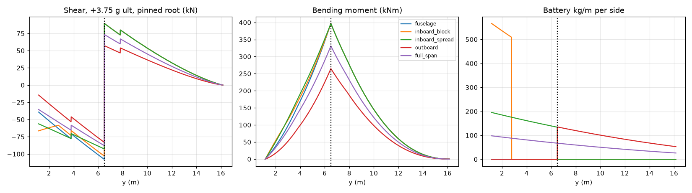

# Structural ('honeycomb' cell-core) wing battery: refined estimate (ESTIMATES)

Refines the wing-box battery idea in battery_study.md (box ≈ 6.4 m³, root box 1.25 × 0.36 m). Script: `battery/structural_wing_pack.py` → `structural_wing_pack.json` / `.png`. Every input marked [A] is an assumption, not X1 data. Load factors are generic CS-23-style ultimate values (limit × 1.5), not certified X1 loads.

## Model

- Half wing, exposed from y0 = 1.15 m (fuselage side) to the tip at 16.15 m. Strut attached at y = 6.5 m, running to the sponson (y 1.25, z 1.45), so the strut angle is ≈ 24.6°.
- Two root bounds: **pinned** (determinate, strut-braced classic) and **clamped** (continuous centre box + rigid strut, propped cantilever, EI ∝ c³ [A]).
- Lift: Schrenk distribution (trapezoid + ellipse)/2, total n·W/2 per side. Inertia: wing structure 900 kg [A] ∝ chord; 4 nacelles of 200 kg each [A] at y 3.8 and 7.8; battery.
- Structural pack mass: cells 1,440 kg (360 kWh at 250 Wh/kg) + potting 167 kg (hex-pack interstitial + 10% end layers, ρ 1.45 g/cc) + busbars/BMS/harness 86 kg [A] + vent/fire barriers 60 kg [A] = **1753 kg**, against 2,057 kg for the conventional pack (cell-to-pack 0.70). Cell envelope 0.59 m³ + potting 0.11 m³. Usable box-section fill 0.55 [A] → 0.64 m³ of box per side (≈ 20% of the box).
- Load cases (ultimate): +3.75 g flight (lift − inertia); −1.5 g flight; 3.0 g landing (no lift, so the wing hangs on root and strut). The landing gear is in the sponsons.

## 1. Spanwise placement and bending relief (pinned root / clamped root)

| Placement | +3.75 g strut tension kN | +3.75 g max wing moment kNm (inboard / outboard of strut) | +3.75 g root shear kN | strut compression, governing (−1.5 g or landing) kN | landing 3 g strut compression kN |
|---|---|---|---|---|---|
| Fuselage pack (baseline) | 474 / 555 | 396/397 (clamped 395/397) | 39 / 73 | 190 / 222 | 65 / 70 |
| Inboard block (full depth, root→y 2.77) | 463 / 552 | 396/397 (clamped 395/397) | 66 / 104 | 185 / 221 | 74 / 73 |
| Inboard of strut, spread (1.15→6.5 m) | 438 / 529 | 396/397 (clamped 395/397) | 56 / 94 | 175 / 212 | 94 / 91 |
| Outboard of strut (6.5→16.15 m) | 338 / 384 | 264/265 (clamped 264/265) | 14 / 34 | 174 / 207 | 174 / 207 |
| Full span ∝ box volume | 388 / 457 | 330/331 (clamped 330/331) | 35 / 64 | 155 / 183 | 134 / 149 |

Key points (estimates):
- **Inboard of the strut gives no bending relief at all.** The peak wing moment is the hogging moment at the strut station (≈ 397 kNm ultimate). It is set purely by the loads outboard of the strut, so inboard cells only shift a little load from the strut to the root.
- **Outboard of the strut gives the relief:** −33% wing moment and −29% strut tension (pinned).
- The outboard placement nearly triples the landing-case strut compression (65 → 174 kN). But the −1.5 g flight case (190 kN) still governs strut buckling, and it drops to 174 kN, so the strut is not penalised. The price is moved elsewhere: higher ground and landing wing loads (more ground-air-ground fatigue range), much bigger roll inertia (Ixx +113% outboard, +64% full-span, +15% inboard-spread, +4% inboard block, vs Ixx ≈ 185,000 kg·m² from R̄x = 0.25 [A]; this roughly doubles the roll time constant and lowers the wing bending and torsion frequencies), and cells 6–16 m from the fuselage (crash/strike exposure, see §4).
- Root shear is small either way (|V_root| 15–100 kN), because the strut takes most of the vertical load.

## 2. Cell-core sandwich: shear and peel (+3.75 g ultimate, at battery stations)

τ_avg = V / (w_box · h_box). The core's share of the shear is set by stiffness: G_core·A_core vs 2 CFRP ±45° webs (G 25 GPa, 3 mm) [A], with G_core = 0.1–0.5 GPa for a potted cell block [A]. Peak = τ_avg / bonded-area fraction 0.6 [A] × shear-lag factor 2.0 [A]. Peel peak = 0.75 × the peak shear [A].

| Placement (pinned / clamped) | core share of shear | τ_avg if core shares [MPa] | τ_avg if core takes all [MPa] | τ_peak, all-core [MPa] | peel peak, all-core [MPa] |
|---|---|---|---|---|---|
| Inboard block (full depth, root→y 2.77) | 30%–68% | 0.05–0.11 / 0.08–0.17 | 0.16 / 0.25 | 0.53 / 0.85 | 0.40 / 0.64 |
| Inboard of strut, spread (1.15→6.5 m) | 29%–67% | 0.09–0.21 / 0.12–0.29 | 0.32 / 0.45 | 1.08 / 1.52 | 0.81 / 1.14 |
| Outboard of strut (6.5→16.15 m) | 23%–60% | 0.05–0.13 / 0.05–0.13 | 0.21 / 0.21 | 0.69 / 0.69 | 0.52 / 0.52 |
| Full span ∝ box volume | 25%–62% | 0.08–0.20 / 0.11–0.26 | 0.31 / 0.41 | 1.02 / 1.35 | 0.76 / 1.01 |

### Sourced adhesive and potting properties (typical datasheet values, not design allowables)

| Material | Typical lap shear [MPa] | Design value at ×0.25 knockdown [A] [MPa] | Other | Source |
|---|---|---|---|---|
| 3M Scotch-Weld DP490 epoxy, Al sandblasted | 23 (23 °C); 9.5 (82 °C); older TDS 30.8 / 13.3 (80 °C) | 5.8 / 2.4 | Bell peel 34.5 N/cm | https://multimedia.3m.com/mws/media/2409614O/3m-scotch-weld-epoxy-adhesive-dp490.pdf ; https://www.generaladhesivos.com/proveedor-pegamento/61hoja-tecnica-Scotch-Weld%20TM%20DP490.pdf |
| LOCTITE UK 2018 2K PU (battery cell/module structural) | 10 (Al/Al); **2 to PET cell film (PSA fails)** | 2.5 / **0.5** | tensile 22 MPa, elong. 10%, k 0.55 W/mK, 1.35–1.58 g/cc | https://datasheets.tdx.henkel.com/LOCTITE-UK-2018-en_GL.pdf |
| LOCTITE TLB 9270APS 2K PU thermally conductive adhesive | 10.5 (Al 3003) | 2.6 | k 2.0 W/mK, 2.04 g/cc, elong. 17.8% | https://dm.henkel-dam.com/is/content/henkel/Product-Info-Sheet---LOCTITE-TLB-9270APS |
| SikaForce-325 CB / L60 PU (cell-to-plate) | 10 | 2.5 | k 1.2 W/mK | https://industry.sika.com/dam/dms/global-industry/b/temperature-managementbeyondtheexpected.pdf |
| CR EVPU4500-A-10AB PU TCA | 16 (Al-Al); 15 after 85 °C/85% RH 1000 h | 3.75 | tensile 17 MPa, elong. 60%, k 1.0 W/mK, −40…85 °C | https://www.crtechinc.com/uploads/datasheets/85.%20EVPU4500-A-10AB.pdf |
| Kisling 8792/8992 PU gap filler (non-structural) | ~0.5 (ABS) | 0.13 | k 2.0 W/mK, −40…120 °C | https://www.kisling.com/fileadmin/dateiliste/dokumente/Technische_Datenblaetter/EN/TDS_8792_8992_e.pdf |

The ×0.25 knockdown [A] lumps B-basis scatter, hot/wet (cells run at 40–60 °C), fatigue (~10⁵–10⁶ gust and GAG cycles) and process variability. It is a sizing-level assumption, not a qualified allowable.

**Result:** with structural PU or epoxy bonded to *bare or primed metal cans*, the peak shear (0.5–1.5 MPa) and peel (0.4–1.1 MPa) are inside the 2.4–3.8 MPa design values. Margins are roughly +60% to +600%, tightest for the clamped inboard-spread case and for hot epoxy. **With PET-wrapped cells, the bond is limited by the film's pressure-sensitive adhesive (2 MPa typical → 0.5 MPa design) and every placement fails in peak shear.** So a structural wing pack needs unwrapped, primed cans, with electrical isolation provided by the potting or a coating rather than the shrink film. The gap-filler class (≈0.5 MPa) cannot be the structural core. Other core loads are small: Brazier crushing pressure is 25–40 kPa, and crash retention at 9 g forward on one cell's end-cap bond is 19 kPa (CS-23 emergency-landing inertia factors 9 g fwd / 3 g up / 6 g down / 1.5 g side, legacy CS 23.561 values [A]).

## 3. Thermal (estimates)

| Item | Value |
|---|---|
| Cell losses: cruise (~1.7C, 3%) / climb 1.2 MW (6%) / takeoff 1.6 MW (8%) [A] | 18 / 72 / 128 kW |
| Adiabatic ΔT, takeoff 60 s + climb to 3000 m at 6 m/s (cp 1.0 kJ/kgK [A]) | **30 K** |
| External convection, turbulent plate at 80 m/s, x = 1 m | h ≈ 131 W/m²K |
| Overall U (CFRP 3 mm, k 0.7 + potting 5 mm, k 1.0 [A]) | 59 W/m²K |
| Rejection through the box skins at ΔT 30 K: full box (55 m²) / inboard block only (8 m²) | 97 / 14 kW |
| Volumetric heat at cruise | 25 kW/m³ |
| Core-centre ΔT (slab, half-depth L) for cell axial k 1.4 (NMC 21700) vs 30 (LFP 18650) W/mK, L = 0.09 / 0.18 m | 72 / 289 K vs 3 / 13 K |

Cell conductivity sources: Drake et al., J. Power Sources 2014 (axial ≈ 30 W/mK, radial ≈ 0.2 for LFP 18650/26650), https://www.sciencedirect.com/science/article/abs/pii/S0378775313019502 ; and Appl. Therm. Eng. 2023 (NMC 18650/21700: axial 1.3–1.5, radial 0.2–0.4 W/mK), https://doi.org/10.1016/j.applthermaleng.2023.119990 .

Conclusions: a **spread** layout can reject cruise losses passively through the skins in flight. The **inboard block cannot** (13 kW capacity vs ~18 kW losses). Climb is effectively adiabatic (+30 K), so the pack must start cool and the 3000 m climb profile matters. On a hot ground turnaround there is no ram air, so a liquid loop or conductive fins are required anyway. With NMC-type low axial conductivity, a full-depth (0.36 m) block at the root has an unacceptable core-to-skin gradient. Keep the cell stack ≤ 2 tiers skin-to-skin (box depth ≤ ~0.2 m, i.e. outboard), or add aluminium fins/cold plates every tier.

## 4. Crash, safety, certification concerns (qualitative)

- Outboard cells are exposed to wing strikes (hangar, ground loop, tree or pole on approach), bird strike on the LE box, and lightning attachment near the tips. Inboard of the strut is safer. Keep a LE crush zone (the front spar ahead of the cells).
- Thermal-runaway containment and venting have to be designed into the wing: vent channels to the lower skin and tip, fire barriers between bays, no venting toward the fuselage, cabin windows or props. A runaway outside the cabin is better for occupants than one under the floor.
- Post-crash: an intact wing is the battery, so firefighters need disconnects and a rescue plan. Wing separation would leave cells energised.
- The wing becomes a primary structure that ages electrochemically. Cell swelling over life (a few % of thickness) loads the bonds in peel. Cells cannot be replaced individually, so pack replacement means a wing-box repair or replacement, which is a large maintenance-cost item.
- The 3.0 g landing and taxi loads on wing-mounted mass raise ground-air-ground fatigue on the strut and wing. Outboard placement triples the landing strut compression.
- Certification: there is no established means of compliance for cells as primary structure. Expect FAA/EASA special conditions plus a building-block test programme (coupons → elements → wing box).

## 5. Mass saving (per aircraft)

| Placement | pack saving kg | wing bending-material saving kg [A: 40% of 900 kg is bending material] | strut Δ kg | systems penalty kg [A] | **net saving kg** |
|---|---|---|---|---|---|
| Inboard block (full depth, root→y 2.77) | 304 | -0 | +1 | -25 | **280** |
| Inboard of strut, spread (1.15→6.5 m) | 304 | -0 | +3 | -50 | **257** |
| Outboard of strut (6.5→16.15 m) | 304 | 120 | +3 | -50 | **377** |
| Full span ∝ box volume | 304 | 60 | +8 | -50 | **321** |

Net saving ≈ 260–380 kg, or 2.3–3.3% of MTOW. That is equivalent to ≈ 45–65 kWh at the 175 Wh/kg pack level, or ≈ +10–15% energy at fixed MTOW. This sits inside battery_study.md's 200–450 kg range but now resolves where the saving comes from: about 300 kg from deleting pack structure (cell-to-pack 0.70 → 0.82), plus 0–120 kg of bending relief that exists only outboard of the strut. The best structural case (outboard) is the worst for crash exposure and roll inertia. The best safety and thermal-simplicity case (inboard block) has no bending relief and cannot reject heat passively.

**Recommended estimate:** spread the cells inboard of the strut up to the outboard nacelle (≈ y 1.2–7.8 m, 2 tiers where depth allows), bonded with structural PU (≥ 10 MPa class) to primed cans, with fin-type conduction to the skins. Net ≈ 250–300 kg saved. Treat outboard placement as a later step only if the crash and vent design closes.

## Limitations
- Beam model with Schrenk lift. No torsion, no chordwise or shear-flow analysis, no gust/flutter or aeroelastic effects. Battery mass in the wing lowers the flutter speed, which needs checking.
- Sandwich stresses use averaged shear plus assumed peak factors; a detailed FE model of the cell-potting-skin interface is the next step.
- All adhesive values are typical datasheet values (sources above); design allowables require test.
