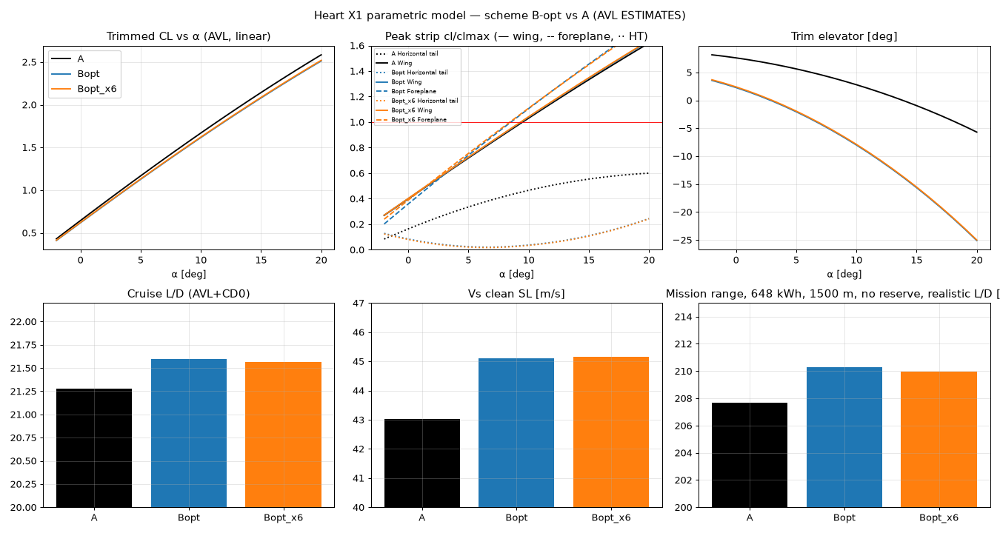
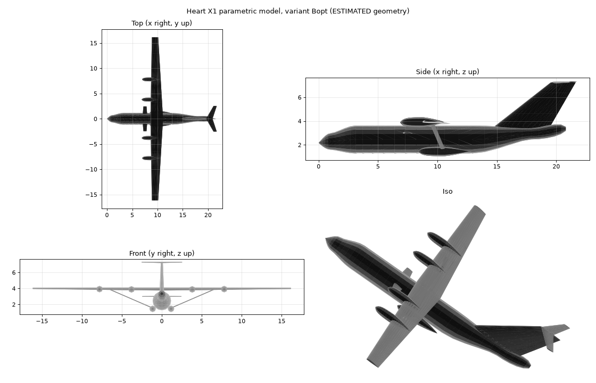

# Scheme B-opt vs baseline A — AVL results (ESTIMATES)

B-opt is the scheme-B three-surface layout (P.180-style) refined by the area×position sweep: **foreplane 4.0 m² at LE x = 7.0 m, incidence +2.0°, no foreplane control; HT reduced to 4.8 m² (scale 0.4 of A's 12 m²); fin unchanged.** Bopt_x6 is the same at x = 6.0 m, which needs +3.0° to stall the foreplane first (+2° gave only a 0.011 CL margin). CG placed for 15% static margin in every comparison. A is shown at the same 15% margin. Method: AVL 3.52 + Raymer CD0, 80 m/s, 3000 m, MTOW 11,340 kg, from the same scripts as the earlier A/B/C runs (analyze.py, high_alpha.py). Files: `bopt.py`, `bopt_inc.py`, `cad_v2.py`, avl/x1_Bopt*.avl/.mass, vsp/x1_Bopt*.vsp3, cad/x1_Bopt*.stl/.step, results/x1_Bopt*_views.png.

## 1. Cruise, trim, stability

| | A (T-tail) | B-opt (x 7.0) | B-opt x 6.0 |
|---|---|---|---|
| CG x [m] (15% SM) | 10.19 | 9.32 | 9.27 |
| CG [% MAC] | 75.5 | 30.8 | 27.9 |
| Neutral point x [m] | 10.48 | 9.62 | 9.56 |
| Static margin [% MAC] | 15.0 | 15.0 | 15.0 |
| Static margin at fixed CG 9.21 m [% MAC] | 65.5 | 20.8 | 17.9 |
| Cruise CL | 0.631 | 0.631 | 0.631 |
| Trim α [deg] | -0.12 | 0.13 | 0.09 |
| Trim pitch control (HT elevator) [deg] | 7.6 | 2.2 | 2.3 |
| CDi trimmed | 0.0078 | 0.0082 | 0.0082 |
| Span efficiency e | 0.952 | 0.892 | 0.884 |
| CD0 (buildup est.) | 0.0219 | 0.0210 | 0.0210 |
| L/D (AVL + CD0) | 21.28 | 21.60 | 21.56 |
| Simple range, range.m method [km] | 140.2 | 142.3 | 142.1 |
| Cnβ [/rad] | 0.094 | 0.105 | 0.105 |
| Clβ [/rad] | -0.033 | -0.029 | -0.029 |

## 2. High-α / stall (critical-section method; clmax assumed wing 1.6, foreplane 1.4, HT 1.2)

| | A | B-opt | B-opt x6 |
|---|---|---|---|
| First surface to reach clmax | Wing | Foreplane | Foreplane |
| Aircraft CL at wing stall | 1.619 | 1.556 | 1.557 |
| Aircraft CL at foreplane stall | – | 1.474 | 1.471 |
| CLmax (first stall) | 1.619 | 1.474 | 1.471 |
| Vs clean, sea level [m/s] | 43.0 | 45.1 | 45.2 |
| Vs [kt] | 83.7 | 87.7 | 87.8 |
| Cmα before stall [/rad] | -1.82 | -1.51 | -1.52 |
| Cmα after strip saturation [/rad] | -4.52 | -2.26 | -2.31 |
| α where trim needs >25° [deg] | – | 20 | 20 |

In both B-opt cases the foreplane reaches its clmax first. The aircraft CL margin to wing stall is 0.08 (x 7.0) and 0.09 (x 6.0). Past foreplane stall, Cmα stays negative (the nose drops: the P.180-type benign stall). The cost is a CLmax lower by about 0.15 and a stall speed about 2 m/s higher than A. The margin depends on the assumed clmax values, so it is ± a lot.

## 3. Climb and engine-out

| | A | B-opt | B-opt x6 |
|---|---|---|---|
| ROC 4 motors, 60 m/s, 1.6 MW·η [fpm] | 1762 | 1763 | 1763 |
| ROC 3 motors [fpm] | 1181 | 1182 | 1182 |
| Climb CDi | 0.0136 | 0.0143 | 0.0143 |
| OEI check speed (1.2 Vs) [m/s] | 51.6 | 54.1 | 54.2 |
| Rudder for outboard engine out [deg] (limit 25) | 11.1 | 8.8 | 8.7 |
| Cn per deg rudder | 0.00150 | 0.00164 | 0.00165 |
| Vmc (aero, rudder 25°) est. [m/s] | 39.4 | 38.3 | 38.2 |

The fin is unchanged and still adequate: about 9–11° of rudder at 1.2 Vs and Vmc ≈ 38–39 m/s, below Vs. B-opt actually needs less rudder, because the higher Vs means a higher check speed and less thrust per motor, and its CG is further forward, which gives the fin a longer arm.

## 4. Dynamic modes (AVL MODE, cruise, 15% SM)

| | A | B-opt | B-opt x6 |
|---|---|---|---|
| Short period ωn [rad/s] / ζ | 1.57 / 0.68 | 1.35 / 0.59 | 1.36 / 0.59 |
| Phugoid period [s] / ζ | 49 / +0.021 | 42 / -0.010 | 42 / -0.009 |
| Dutch roll ωn [rad/s] / ζ | 1.13 / 0.122 | 1.19 / 0.131 | 1.19 / 0.131 |
| Roll time constant [s] | 0.25 | 0.25 | 0.25 |
| Spiral (unstable) time to double [s] | 27 | 26 | 26 |

Short period and dutch roll are well damped in all cases. The spiral is mildly divergent in all cases (T2 ≈ 26 s; MIL-F-8785C Level 1 needs ≥ 20 s for flight-phase category B/C) → OK. **The B-opt phugoid is neutral to very slightly divergent (ζ ≈ −0.01, T2 ≈ 8 min), against ζ = +0.02 for A.** AVL's phugoid damping is unreliable (no CD(V) or thrust modelling), so read this as 'phugoid lightly damped in both; watch it', not as a defect.

## 5. Takeoff rotation (nose-wheel lift-off about the main gear x 10.1 m, HT elevator −25°, α 0, full thrust, no flaps or ground effect)

| | A | B-opt | B-opt x6 |
|---|---|---|---|
| CG ahead of main gear [m] | -0.09 | 0.78 | 0.83 |
| Cm about gear, elevator −25° | 1.854 | 0.857 | 0.880 |
| VR = 1.1 Vs [m/s] | 47.3 | 49.6 | 49.7 |
| Net nose-up moment at VR [kNm] | 206 | -33 | -35 |
| Pitch acceleration at VR [deg/s²] | 36.6 | -5.8 | -6.1 |
| Minimum nose-wheel lift-off speed [m/s] | 32.5 | 54.0 | 54.0 |

**Rotation is the B-opt weak point.** The 4.8 m² HT with the elevator alone gives about 152 kNm nose-up at V_R. That is less than the weight moment (CG 0.78 m ahead of the gear, ≈87 kNm) plus the thrust-line moment (thrust about 3.85 m above the gear, ≈99 kNm). The nose wheel only lifts at ≈54 m/s ≈ 1.2 Vs. Fixes, any one of which should do it (estimates): a foreplane flap or elevator like the P.180's (the foreplane is fixed in this model); HT about 6–6.5 m²; HT elevator chord 0.35 → 0.45; or accept VR ≈ 1.2 Vs (a longer ground roll). **A's result is not meaningful.** At 15% SM its CG (10.19 m) is behind the assumed main gear (10.1 m), a tip-back condition. So either the real X1 flies with a larger static margin (the CG at 9.21 m gives 65% SM in this model; the model's T-tail is probably oversized or its arm too long) or the gear is further aft than the photo estimate. This is an inconsistency in the photo-derived geometry, not an X1 property.

## 6. Mission range (battery_study.py mission model: taxi, TO, climb at 1.2 MW, cruise at 80 m/s, descent; 0.9 SOC window)

'Realistic' L/D adds an ASSUMED ΔCD0 = +0.006 for interference, props/slipstream, cooling, excrescences and gear fairings. Si-anode: a 450 Wh/kg cell × 0.70 cell-to-pack = 315 Wh/kg at the same pack mass (2,057 kg) → 648 kWh. 'infeas.' = the reserve cannot be met.

| Variant | L/D basis | L/D | 360 kWh 3000 m none | 360 kWh 3000 m 30 min | 360 kWh 1500 m none | 360 kWh 1500 m 30 min | 648 kWh 3000 m none | 648 kWh 3000 m 30 min | 648 kWh 1500 m none | 648 kWh 1500 m 30 min |
|---|---|---|---|---|---|---|---|---|---|---|
| A | AVL+CD0 | 21.28 | 107 | infeas. | 124 | infeas. | 233 | 118 | 250 | 135 |
| A | realistic(+0.006) | 17.70 | infeas. | infeas. | 103 | infeas. | 194 | infeas. | 208 | 92 |
| Bopt | AVL+CD0 | 21.60 | 109 | infeas. | 125 | infeas. | 237 | 122 | 253 | 138 |
| Bopt | realistic(+0.006) | 17.92 | infeas. | infeas. | 104 | infeas. | 196 | infeas. | 210 | 95 |
| Bopt_x6 | AVL+CD0 | 21.56 | 109 | infeas. | 125 | infeas. | 236 | 121 | 253 | 138 |
| Bopt_x6 | realistic(+0.006) | 17.89 | infeas. | infeas. | 104 | infeas. | 196 | infeas. | 210 | 95 |

B-opt gains about 1.5–2 km (+1.5%) over A in every mission case. The battery chemistry and the cruise altitude matter ~100× more: with 360 kWh and a 30-min reserve, no case closes; climbing to 3000 m costs more energy than it saves at 80 m/s; the Si-anode pack roughly doubles the no-reserve range. The simple range.m figure (~142 km) ignores taxi, climb and the SOC window. The mission model is the better estimate.

## 7. Verdict (estimates)

- B-opt (4 m² foreplane at x 7.0, +2°, HT 4.8 m²) trims at 15% SM with L/D 21.6 vs 21.3 (+1.5%), keeps foreplane-first stall with a nose-down break, and keeps climb, OEI and the lateral-directional modes unchanged.
- Costs: CLmax −0.15 (Vs +2 m/s); the phugoid is slightly less damped; and **rotation authority is inadequate with an HT-only elevator**. B-opt needs a foreplane flap or a larger HT/elevator, and that erodes part of the 1.5%.
- x = 6.0 m is no better: it needs more incidence and has the same L/D within 0.05.
- Net: a small, real but fragile gain. It is within the uncertainty of the photo-derived geometry (± several % in L/D).

Views: 

## Assumptions / limitations

- VLM (no viscous stall; clmax per surface assumed), Raymer CD0, no prop slipstream, no ground effect, no flaps.
- Geometry is photo-derived (params.yaml uncertainties apply). Mass and inertia are radius-of-gyration estimates.
- CAD bug found and fixed during this task: OpenVSP POD `FineRatio` is length/radius, so the earlier CAD pods (nacelles, sponsons) had twice the intended diameter. Corrected CAD: cad/x1_{A,B,C}_v2.*, cad/x1_Bopt*.*, cad/x1_*_cfd.stl (fine tessellation). The original A/B/C CAD files were left untouched, as instructed. The AVL/CD0 results never used the CAD and are unaffected.
